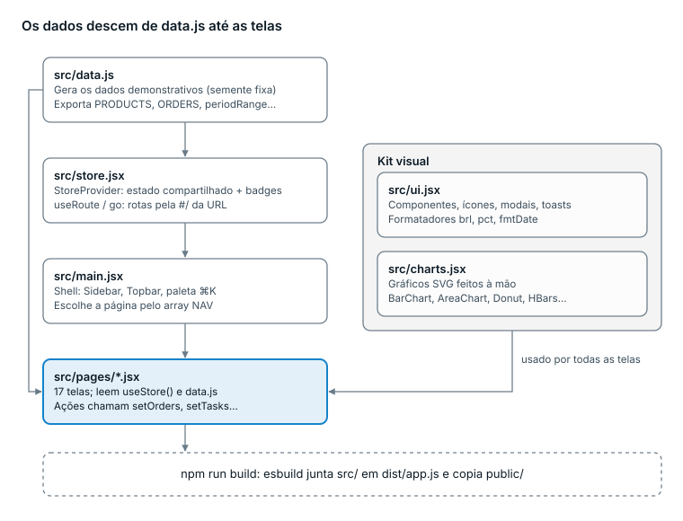

# Wiki — Glasses Admin Dashboard

## Visão geral

O Glasses Admin Dashboard (a loja de demonstração se chama Vitrine) é um painel administrativo e financeiro de e-commerce feito só de front-end: React 18 + Framer Motion, empacotado com esbuild em arquivos estáticos. **Hoje ele não tem backend, banco de dados, login nem chamadas de API** — todos os números vêm de um gerador de dados demonstrativos em `src/data.js`.

Isso define o que significa "dar continuidade": a interface está pronta (17 telas, 4 temas, busca rápida, exportação CSV); o próximo passo grande é ligar essas telas a uma API real.

**Para quem é:** a equipe interna da loja (dono, financeiro, operação, atendimento, moderação de sellers).

**O que ele faz hoje:**

- Mostra faturamento, pedidos e ticket médio por período (hoje, 7 dias, 30 dias, mês, 90 dias, ano, 12 meses ou personalizado), sempre comparando com o período anterior.
- Lista produtos, pedidos, clientes, equipe, tickets de atendimento e anúncios de sellers, com busca, filtros e paginação.
- Permite ações simuladas: avançar status de pedido, aprovar/recusar anúncio, marcar repasse como pago, ligar/desligar integração. Essas ações mudam o estado **só na memória do navegador** e somem ao recarregar a página.
- Exporta tabelas em CSV (separador `;`, pronto para o Excel em português).
- Busca global com ⌘K / Ctrl+K ou a tecla `/`.
- Quatro temas visuais (Oceano, Aurora, Névoa, Grafite); o tema escolhido fica salvo no `localStorage`.

## Stack e bibliotecas

O projeto tem só quatro dependências. Gráficos, ícones, modais, toasts e roteamento foram escritos à mão — não procure Recharts, React Router ou Redux, eles não estão aqui.

| Biblioteca | Versão | Tipo | Para que serve | Onde aparece |
| --- | --- | --- | --- | --- |
| react | 18.3.1 | produção | Componentes, estado (`useState`, `useMemo`, `useEffect`) e Context | Todos os arquivos `.jsx` |
| react-dom | 18.3.1 | produção | Desenha o app na página (`createRoot`) e abre modais fora da árvore (`createPortal`) | `src/main.jsx`, `src/ui.jsx` |
| framer-motion | 11.18.2 | produção | Animações: entrada das páginas, molas, `AnimatePresence` para itens que saem, `layoutId` da pílula do menu | Quase todas as telas |
| esbuild | ^0.28.2 | desenvolvimento | Junta todo o `src/` num único `dist/app.js` minificado e converte JSX em JavaScript | `build.cjs` |

**Fora do `package.json`, mas usado:**

- **serve** (via `npx serve`): servidor estático simples para abrir o `dist/` no navegador. É baixado na hora pelo `npx`.
- **Fonte Inter** (Google Fonts), carregada no `public/index.html`. Em Mac/iPhone o sistema usa a SF Pro nativa.
- **marked** (via cdnjs), usado só por esta página da wiki para transformar o `wiki.md` em HTML.
- **APIs do navegador:** `Intl.NumberFormat` (moeda em R$), `localStorage` (tema salvo), `Blob` + `URL.createObjectURL` (download do CSV), `hashchange` (rotas).

**O que foi feito à mão e onde está:**

| Recurso | Arquivo | Observação |
| --- | --- | --- |
| Gráficos (barras, área, rosca, anel, barras horizontais, sparkline) | `src/charts.jsx` | SVG puro, com tooltip e animação |
| Ícones | `src/ui.jsx` (objeto `P`, componente `Icon`) | Caminhos SVG; para um ícone novo, adicione uma entrada em `P` |
| Componentes de UI (Card, Button, Modal, Drawer, Popover, Toast, Badge, Stat…) | `src/ui.jsx` | O "kit" do projeto; reutilize antes de criar outro |
| Formatadores (`brl`, `brlK`, `pct`, `int`, `fmtDate`, `ago`) | `src/ui.jsx` | Sempre em pt-BR |
| Roteamento | `src/store.jsx` (`useRoute`, `go`) | Baseado em `#/rota?param=valor` |
| Estado global | `src/store.jsx` (`StoreProvider`, `useStore`) | React Context, sem Redux |

## Estrutura de pastas e arquitetura

O código inteiro cabe em 13 arquivos de `src/` (cerca de 3.200 linhas) mais um CSS. Cada pasta tem um papel só:

```
Glasses-Admin-Dashboard/
├─ package.json      dependências e scripts (build, dev)
├─ build.cjs         script de build com esbuild
├─ start.bat         liga o site em localhost:3000 com dois cliques (Windows)
├─ serve.ps1         servidor plano B do start.bat quando não há Node.js
├─ public/
│  ├─ index.html     página base: fonte, tema salvo, <div id="root">
│  ├─ styles.css     todo o visual: variáveis de cor, 4 temas, responsivo
│  └─ wiki/          esta wiki (index.html + wiki.md + diagrama)
├─ src/
│  ├─ main.jsx       ponto de entrada: menu (NAV), Sidebar, Topbar, paleta ⌘K, Shell
│  ├─ store.jsx      rotas (#/), temas e estado compartilhado (StoreProvider)
│  ├─ data.js        gerador dos dados demonstrativos + cálculos de período
│  ├─ ui.jsx         componentes, ícones, formatadores, toasts, CSV
│  ├─ charts.jsx     gráficos em SVG
│  └─ pages/         uma ou mais telas por arquivo
└─ dist/             resultado do build (não edite à mão)
```



Como ler: `StoreProvider` envolve o app inteiro, então qualquer tela chama `useStore()` para ler ou alterar pedidos, tarefas, repasses etc. As telas também importam `data.js` direto (seta da esquerda) para cálculos que não mudam, como `periodRange` e `productStats`. Quando uma tela chama `setOrders(...)`, o React redesenha tudo que depende disso, inclusive os badges do menu.

**Ordem de montagem** (fim de `src/main.jsx`): `MotionConfig` → `StoreProvider` → `ToastProvider` → `Shell`. O `Shell` lê a rota com `useRoute()`, acha o item correspondente em `NAV` e renderiza a página passando `params`. Rota desconhecida cai na Visão geral.

## Instalação passo a passo

Você precisa só de Node.js e de um terminal; não há banco, Docker nem variáveis de ambiente para configurar.

**Pré-requisitos**

- Node.js 18 ou mais novo (o LTS atual serve). Confira com `node -v`.
- npm, que já vem com o Node. Confira com `npm -v`.
- Um editor; o VS Code reconhece JSX sem configuração extra.

**Onde está o código**

O projeto fica no GitHub em [erickdev888/Glasses-Admin-Dashboard](https://github.com/erickdev888/Glasses-Admin-Dashboard), no branch `main`. Para baixar (precisa do [Git](https://git-scm.com) instalado):

```bash
git clone https://github.com/erickdev888/Glasses-Admin-Dashboard.git
```

Isso cria a pasta `Glasses-Admin-Dashboard` com tudo, inclusive o build pronto em `dist/`. Sem Git, use **Code → Download ZIP** na página do repositório.

**Jeito mais rápido no Windows: `start.bat`**

Dê dois cliques em `start.bat` na raiz do projeto. Ele abre o painel em `http://localhost:3000` sozinho e escolhe o caminho conforme o que tem instalado:

| Situação | O que o `start.bat` faz | Mudanças em `src/` aparecem? |
| --- | --- | --- |
| Node.js instalado | `npm install` (só na primeira vez) → `npm run build` → `npx serve dist` na porta 3000 → abre o navegador | Sim, toda vez que você roda o `start.bat` de novo |
| Sem Node.js, mas com `dist/` | Serve a versão já compilada com `serve.ps1` (PowerShell, sem instalar nada) | Não: instale o Node.js para recompilar |
| Sem Node.js e sem `dist/` | Avisa para instalar o Node.js LTS em nodejs.org e para | — |

Para desligar o servidor, feche a janela preta ou aperte Ctrl+C. Se a porta 3000 já estiver ocupada, troque `set "PORT=3000"` no topo do `start.bat`. A wiki local fica em `http://localhost:3000/wiki/`.

`serve.ps1` é um servidor estático mínimo em PowerShell (`HttpListener`) que só aceita conexões de `localhost`. Ele existe só como plano B; com Node.js instalado ele não é usado.

Prefere o terminal ou está no Mac/Linux? Siga o passo a passo abaixo.

**Rodando na sua máquina**

1. Clone o repositório (veja acima) e abra a pasta `Glasses-Admin-Dashboard` no terminal.
2. Instale as dependências:

```bash
npm install
```

3. Gere o build e suba o servidor local:

```bash
npm run dev
```

Esse comando roda `node build.cjs` e depois `npx serve dist`. Na primeira vez o npx pergunta se pode baixar o `serve`: responda `y`.

4. Abra o endereço que o terminal mostrar (normalmente `http://localhost:3000`).

**Atenção: não há recarregamento automático.** Depois de editar algo em `src/` ou `public/`, rode `npm run build` de novo e atualize o navegador (F5). O servidor do `serve` pode continuar aberto em outro terminal.

**O que o build faz (`build.cjs`)**

1. Cria a pasta `dist/` se ela não existir.
2. Chama o esbuild com `src/main.jsx` como ponto de entrada: segue todos os `import`, converte JSX, minifica e grava um único `dist/app.js` (formato ES module, alvo ES2020 e Safari 15).
3. Define `process.env.NODE_ENV = "production"`, para o React rodar no modo rápido.
4. Copia tudo de `public/` para `dist/`, incluindo subpastas como `public/wiki/`.

**Publicando**

A pasta `dist/` é o site completo, só arquivos estáticos. Pode ir para qualquer hospedagem estática (GitHub Pages, Netlify, Vercel, S3, um nginx). Como as rotas usam `#/`, nenhuma regra de redirecionamento é necessária.

O site oficial está no GitHub Pages: [erickdev888.github.io/Glasses-Admin-Dashboard](https://erickdev888.github.io/Glasses-Admin-Dashboard/), e esta wiki em [/wiki/](https://erickdev888.github.io/Glasses-Admin-Dashboard/wiki/). O site mostra o conteúdo da pasta `dist/` que está no branch `gh-pages`; o código-fonte fica no `main`.

Para publicar uma versão nova depois de mudar o código:

1. `npm run build` para regerar o `dist/`.
2. `git add -A` e `git commit -m "Descreva a mudança"`.
3. `git push` para enviar o código ao `main`.
4. `git subtree push --prefix dist origin gh-pages` para publicar o novo `dist/` no site.

Em 1 a 2 minutos a versão nova aparece. Se continuar a antiga, force a atualização com Ctrl+Shift+R. Esquecer o passo 1 publica o build antigo; esquecer o passo 4 deixa o site sem a mudança.

**Problemas comuns**

| Sintoma | Causa provável | Como resolver |
| --- | --- | --- |
| Mudei o código e nada mudou | O `dist/` não foi regerado | `npm run build` e F5 (Ctrl+Shift+R para ignorar cache) |
| Tela em branco ao abrir `dist/index.html` com duplo clique | Navegadores bloqueiam `type="module"` em `file://` | Abra via `npx serve dist` ou `start.bat`, nunca direto do disco |
| `Cannot find module 'esbuild'` | `npm install` não rodou | Rode `npm install` na pasta do projeto |
| Erro de sintaxe no build | JSX inválido | O esbuild mostra arquivo e linha; corrija e rode de novo |
| Acentos estranhos (ç, ã) ao abrir arquivo | Editor abrindo em outra codificação | Os arquivos são UTF-8; configure o editor para UTF-8 |

## Integrações

Nenhuma integração está conectada de verdade. A tela **Integrações** mostra 12 cartões (gateway de pagamento, Pix, boleto, Correios, transportadoras, ERP, NF-e, comparadores de preço, marketplaces, WhatsApp, Telegram, Analytics), mas o botão de liga/desliga só troca o campo `on` no estado em memória e mostra um toast. Os "eventos em 24 h" são números sorteados.

O mesmo vale para o resto: a lista de serviços e latência da tela **Sistema**, o "Sair" do menu do usuário (só mostra "Sessão encerrada (demonstração)") e o usuário logado, fixo em `ADMIN` no fim de `src/data.js`.

**De onde vêm os dados hoje**

`src/data.js` usa um gerador pseudoaleatório com semente fixa (`mulberry32(20261108)`). Por isso os números são iguais a cada recarga, mas as datas são relativas a hoje. Ele gera 730 dias de vendas por produto (12 meses exibidos + 12 para comparação), com sazonalidade (Black Friday, dia da semana), e a partir disso os pedidos, clientes, tickets etc.

| Export de `data.js` | O que é | Quem usa |
| --- | --- | --- |
| `PRODUCTS`, `productById`, `CATEGORIES` | Catálogo com vendas diárias (`units`, `revenue`) e somas acumuladas (`cu`, `cr`) | Visão geral, Produtos, Relatórios, Financeiro, busca |
| `periodRange`, `productStats`, `seriesFor`, `monthly`, `categoryTotals` | Cálculos de período e comparação | Telas com seletor de período e gráficos |
| `ORDERS`, `ORDER_STATUS` | 260 pedidos recentes e seus status | Pedidos, Visão geral |
| `CUSTOMERS`, `TEAM`, `ROLES`, `PERMISSIONS` | Pessoas e permissões | Clientes, Equipe, Funções |
| `LISTINGS`, `PAYOUTS`, `INVOICES` | Anúncios de sellers, repasses, faturas do plano | Moderação, Financeiro, Cobrança |
| `TICKETS`, `ANNOUNCEMENTS`, `TASKS`, `ACTIVITY` | Operação do dia a dia | Atendimento, Comunicados, Tarefas, Log |
| `INTEGRATIONS`, `SERVICES`, `LATENCY` | Catálogo de integrações e saúde do sistema | Integrações, Sistema |
| `FUNNEL`, `REGIONS` | Funil de conversão e vendas por região | Relatórios |
| `ADMIN` | Usuário logado (nome, cargo, nome da loja) | Barra superior, saudação |

**Como ligar a uma API real (caminho sugerido)**

1. Defina com o backend os formatos de resposta. O jeito mais barato é a API devolver objetos no mesmo formato que `data.js` produz hoje (por exemplo, pedido com `id`, `customer`, `items`, `total`, `status`); assim as telas quase não mudam.
2. Crie um módulo `src/api.js` com uma função por recurso (`getOrders()`, `updateOrderStatus(id, status)`…) usando `fetch`. Coloque a URL base numa constante no topo do arquivo; o esbuild pode injetá-la no build via `define`, do mesmo jeito que já faz com `NODE_ENV`.
3. No `StoreProvider` (`src/store.jsx`), troque os valores iniciais (`useState(ORDERS)`) por estado vazio + um `useEffect` que chama a API e guarda o resultado. Adicione estados de carregando e erro.
4. Nas ações (avançar pedido, aprovar anúncio, pagar repasse, ligar integração), chame a API antes ou junto do `set...` local, e mostre um toast de erro se falhar.
5. Os gráficos de faturamento dependem de séries diárias por produto (`p.revenue[dia]`). Para volume real, o ideal é a API devolver já agregado por período, e `productStats`/`seriesFor` virarem chamadas de API.
6. Autenticação: hoje não existe. Será preciso uma tela de login, guardar o token (de preferência em cookie `HttpOnly` definido pelo backend) e substituir o `ADMIN` fixo pelos dados do usuário logado.
7. Quando a migração terminar, remova o rodapé "Dados demonstrativos" em `src/main.jsx`.

## Como funciona cada tela

São 17 telas em quatro seções do menu, todas registradas no array `NAV` de `src/main.jsx`. A coluna **Rota** é o que aparece depois do `#/` na URL. Nenhuma ação sobrevive a um F5, exceto a troca de tema.

| Seção | Tela | Rota | Arquivo | O que mostra | Ações (todas simuladas) |
| --- | --- | --- | --- | --- | --- |
| Painel | Visão geral | `visao-geral` | `pages/overview.jsx` | Faturamento do dia/mês, gráficos por categoria, últimos pedidos | Atalhos para outras telas |
| Painel | Relatórios | `relatorios` | `pages/reports.jsx` | Faturamento por período, funil, regiões, mapa de calor dia × hora | "Baixar PDF" (só toast) |
| Painel | Tarefas | `tarefas` | `pages/people.jsx` (`Tasks`) | Lista de tarefas da equipe | Criar, concluir, excluir com desfazer |
| Pessoas | Equipe | `equipe` | `pages/people.jsx` (`Team`) | Membros, status online | Convidar membro |
| Pessoas | Funções e acesso | `funcoes` | `pages/people.jsx` (`Roles`) | Matriz função × permissão | Ligar/desligar permissões (dono sempre total) |
| Pessoas | Clientes | `clientes` | `pages/people.jsx` (`Clients`) | Base de clientes, nível, LTV | Busca (aceita `?q=` na URL) |
| Pessoas | Atendimento | `atendimento` | `pages/people.jsx` (`Support`) | Tickets por canal e prioridade | Resolver ticket |
| Pessoas | Comunicados | `comunicados` | `pages/people.jsx` (`Announcements`) | Avisos internos | Enviar agora/agendar, excluir |
| Negócio | Produtos | `produtos` | `pages/products.jsx` | Faturamento por produto no período, gráfico e detalhe em gaveta | Trocar período, ordenar, exportar CSV, novo produto (vai para moderação) |
| Negócio | Pedidos | `pedidos` | `pages/orders.jsx` | 260 pedidos, filtros por status, 12 por página | Avançar status, cancelar, exportar CSV, gerar etiquetas |
| Negócio | Moderação | `moderacao` | `pages/moderation.jsx` | Anúncios de sellers com checagens automáticas | Aprovar, recusar com motivo, aprovar todos os sem pendência |
| Negócio | Financeiro | `financeiro` | `pages/finance.jsx` (`Finance`) | Receita, taxas, repasses a sellers | Pagar repasses via Pix, exportar CSV |
| Negócio | Cobrança | `cobranca` | `pages/finance.jsx` (`Billing`) | Plano da plataforma, uso, faturas | Baixar faturas, atualizar cartão |
| Sistema | Log de atividades | `atividade` | `pages/system.jsx` (`Activity`) | Histórico de alterações | Busca e filtro |
| Sistema | Integrações | `integracoes` | `pages/system.jsx` (`Integrations`) | 12 integrações por grupo | Ligar/desligar |
| Sistema | Sistema | `sistema` | `pages/system.jsx` (`System`) | Uptime e latência por serviço | Limpar cache |
| Sistema | Configurações | `configuracoes` | `pages/system.jsx` (`Settings`) | Dados da loja, regras, notificações, tema | Salvar, modo manutenção |

**Elementos presentes em todas as telas** (todos em `src/main.jsx`):

- **Sidebar:** menu com badges numéricos. Os números vêm de `badges` no `StoreProvider` e mudam quando você age (ex.: aprovar um anúncio diminui o badge de Moderação).
- **Barra superior:** busca, seletor de tema, Insights (4 dicas calculadas das vendas dos últimos 7 dias), notificações e menu do usuário.
- **Paleta de comandos (⌘K / Ctrl+K ou `/`):** busca páginas, produtos, pedidos e clientes; ignora acentos e maiúsculas.
- **Transição entre páginas:** a página atual desfoca e some em 0,2 s antes da nova entrar. Quem tem "reduzir movimento" ligado no sistema não vê animações (`MotionConfig reducedMotion="user"`).

**Parâmetros na URL:** algumas telas abrem algo direto pela rota. Exemplos: `#/produtos?p=p3` abre a gaveta do produto p3, `#/pedidos?o=1234` abre o pedido, `#/clientes?q=Ana` já vem filtrado. As páginas recebem isso pela prop `params`.

## Guia do dev júnior

**Receita: adicionar uma tela nova**

Exemplo: uma tela "Cupons" na seção Negócio.

1. Crie `src/pages/coupons.jsx` exportando um componente. Copie o esqueleto de uma tela simples (`moderation.jsx` é um bom modelo):

```jsx
import React from 'react';
import { Card, CardHead, PageHeader, Button, useToast } from '../ui.jsx';
import { useStore } from '../store.jsx';

export default function Coupons({ params }) {
  const toast = useToast();
  return (
    <>
      <PageHeader title="Cupons" subtitle="Descontos ativos na loja">
        <Button icon="plus" variant="primary" onClick={() => toast('Cupom criado')}>Novo cupom</Button>
      </PageHeader>
      <Card><CardHead title="Ativos" /></Card>
    </>
  );
}
```

2. Em `src/main.jsx`, importe a tela (`import Coupons from './pages/coupons.jsx';`) e adicione `{ id: 'cupons', label: 'Cupons', icon: 'tag', page: Coupons }` na seção Negócio do `NAV`. O `id` vira a rota `#/cupons` e entra na busca ⌘K sozinho.
3. Se os dados precisam ser compartilhados com outras telas ou alterados por ações, crie o estado no `StoreProvider` (`src/store.jsx`) e inclua-o no `value` e na lista de dependências do `useMemo`. Se só essa tela usa, `useState` dentro dela basta.
4. Para um badge no menu, adicione uma chave com o mesmo `id` em `badges` dentro do `StoreProvider`.
5. `npm run build`, F5 e confira.

**Convenções do código**

- Textos da interface, nomes de rota e comentários em português; nomes de variáveis e funções em inglês.
- Dinheiro sempre via `brl()` / `brlK()`, porcentagem via `pct()`, datas via `fmtDate()`; nunca formate números à mão.
- Reutilize os componentes de `src/ui.jsx` (`Card`, `Button`, `Badge`, `Modal`, `Drawer`, `Segmented`, `Stat`, `Empty`) antes de criar novos.
- Feedback de ação = toast: `const toast = useToast(); toast('Mensagem', { icon: 'check', tone: 'green' })`. Ações destrutivas oferecem desfazer (`action: { label: 'Desfazer', run }`).
- Navegação programática: `go('pedidos', { o: '1234' })`, nunca `window.location` direto.
- Animações: use as constantes `spring`, `softSpring`, `ease`, `stagger` e `rise` de `ui.jsx` para manter o mesmo ritmo.
- Cores e espaçamentos vêm das variáveis CSS de `public/styles.css` (`--ink`, `--card`, `--accent`, `--s1`…`--s8`). Um tema novo é um bloco `[data-theme="nome"] { … }` no CSS + uma entrada em `THEMES` (`src/store.jsx`).
- Layout responsivo por `@media` em `styles.css` (quebras em 1280, 1024, 700, 420 e 380 px). Teste no celular: abaixo de 1024 px o menu vira gaveta.

**Cuidados**

- O `dist/` é versionado no `main` e publicado no `gh-pages`. Sempre rode `npm run build` antes do commit, para os dois ficarem iguais ao código.
- `data.js` usa um gerador com semente; se você inserir uma chamada nova a `rng()` no meio do arquivo, **todos os números depois dela mudam**. Normal, mas assusta na primeira vez.
- Não há testes automatizados nem linter configurados. Antes de entregar, clique pelas telas que você mexeu e pelas que usam o mesmo estado.
- Esta wiki é o arquivo `public/wiki/wiki.md`. Mudou o projeto? Atualize a wiki no mesmo commit.

**Glossário**

| Termo | Significado |
| --- | --- |
| Seller | Lojista parceiro que vende pelo marketplace da Vitrine |
| Repasse | Valor que a Vitrine paga ao seller, já descontada a comissão |
| Ticket médio | Faturamento ÷ número de pedidos (ou unidades) |
| LTV | Quanto um cliente já gastou ao longo do tempo |
| Badge | Número ao lado do item do menu |
| Toast | Aviso rápido que aparece no canto e some sozinho |
| Drawer | Gaveta lateral com detalhes (ex.: detalhe do pedido) |
| Hash routing | Rotas depois do `#` na URL; o navegador não recarrega a página |
| Bundle | O `dist/app.js` gerado pelo esbuild com todo o código junto |
